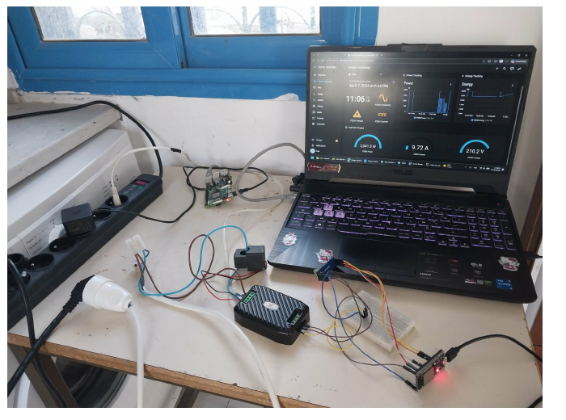
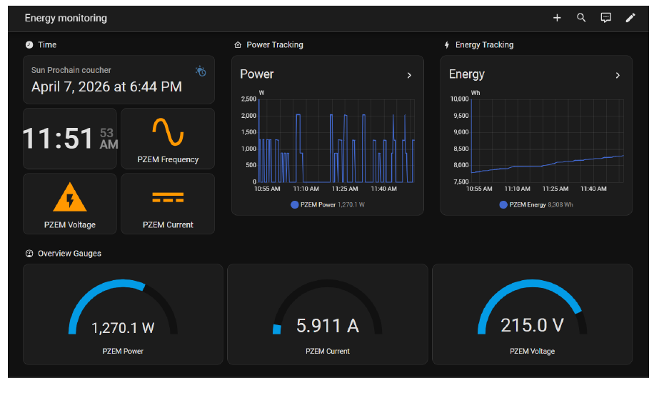
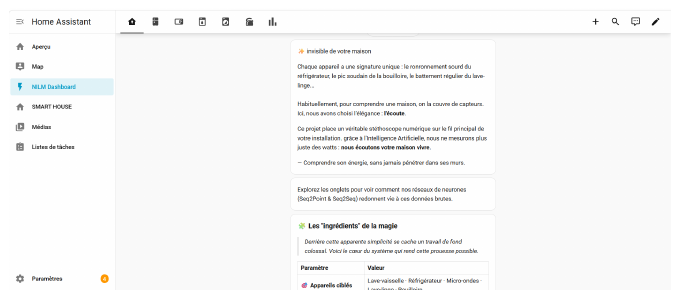
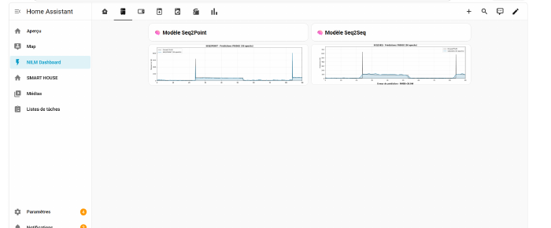

# NILM — Désagrégation non intrusive de la charge électrique

> Projet de Fin d'Année 2 — ENIT (Université de Tunis El Manar), Département TIC, 2ᵉ année TEL 2 — année universitaire 2025/2026
> **Auteures :** Imen Nouma · Arwa Kassebi
> **Encadrants :** M. Sejir Khojet El Khil · M. Lotfi Chaarabi

À partir d'un **unique signal de consommation agrégé** (celui d'un compteur intelligent), ce projet estime la consommation **individuelle** de cinq appareils domestiques grâce au deep learning, puis affiche les résultats dans un tableau de bord **Home Assistant** alimenté par une chaîne d'acquisition **ESP32 + MQTT + Raspberry Pi**.

📄 Rapport complet : [`docs/rapport_PFA_NILM.pdf`](docs/rapport_PFA_NILM.pdf)

---

## Sommaire

1. [Aperçu](#aperçu)
2. [Structure du dépôt](#structure-du-dépôt)
3. [Partie 1 — Étude Seq2Point vs Seq2Seq](#partie-1--étude-seq2point-vs-seq2seq)
4. [Partie 2 — Système d'acquisition et de visualisation](#partie-2--système-dacquisition-et-de-visualisation)
5. [Exécuter les notebooks](#exécuter-les-notebooks)
6. [Limites et perspectives](#limites-et-perspectives)
7. [Références](#références)

---

## Aperçu

Le problème : le signal total d'une maison s'écrit

```
P_total(t) = Σ_i p_i(t) + ε(t)
```

et l'on cherche à retrouver chaque `p_i(t)` — un problème inverse sous-déterminé.

Le projet comporte deux volets complémentaires :

| Volet | Contenu | Où ? |
|---|---|---|
| **1. Étude comparative** | Deux CNN 1D (Seq2Point, Seq2Seq) entraînés sur UK-DALE pour 5 appareils, évalués en *cross-house* | [`notebooks/`](notebooks/) |
| **2. Système temps réel** | ESP32 + PZEM-004T → MQTT (Mosquitto) → Home Assistant sur Raspberry Pi 4 | [`homeassistant/`](homeassistant/), [`firmware/`](firmware/) |

```
Axe 1 : acquisition                         Axe 2 : désagrégation
ESP32 + PZEM-004T (mesure toutes les 6 s)   Entraînement sur Kaggle (GPU T4 ×2)
        │  MQTT  home/pzem                          │  export PNG (5 appareils × 2 modèles)
        ▼                                           ▼  SFTP → /config/www/nilm/
 Mosquitto (Raspberry Pi 4) ───────────►  Home Assistant (tableaux de bord)
```

## Structure du dépôt

```
.
├── README.md
├── requirements.txt
├── LICENSE
├── notebooks/                      # Entraînement + évaluation (1 notebook par appareil)
│   ├── 01_dishwasher.ipynb         # Lave-vaisselle
│   ├── 02_fridge.ipynb             # Réfrigérateur
│   ├── 03_washing_machine.ipynb    # Machine à laver
│   ├── 04_kettle.ipynb             # Bouilloire
│   └── 05_microwave.ipynb          # Micro-ondes
├── homeassistant/                  # Configuration MQTT + exemple de carte de tableau de bord
├── firmware/                       # Spécification du firmware ESP32 (code à ajouter)
└── docs/
    ├── rapport_PFA_NILM.pdf        # Rapport complet
    └── images/                     # Figures du rapport (montage, tableaux de bord)
```

Chaque notebook est **autonome** : il charge les données, entraîne les deux modèles, évalue, trace les prédictions et sauvegarde les résultats.

---

## Partie 1 — Étude Seq2Point vs Seq2Seq

### Données

- **Jeu de données :** [UK-DALE](https://jack-kelly.com/data/) — 5 foyers britanniques, agrégat échantillonné à 6 s (fichier HDF5).
- **Entraînement / validation :** maison 1 (avril 2013 – mars 2014), 85 % / 15 %.
- **Test :** maisons 2 et 5, jamais vues à l'entraînement (évaluation de la généralisation inter-foyers).
- **Prétraitement :** conversion `float32`, grille temporelle commune à 6 s (plus proche voisin, tolérance 6 s), valeurs manquantes à 0, normalisation `StandardScaler` (paramètres estimés sur le train uniquement), fenêtres glissantes avec padding symétrique.

### Modèles

Les deux architectures partagent le même tronc convolutif ; seule la couche de sortie diffère.

```
Entrée (W×1)
 → Conv1D 30f k10 → BN → Dropout 0.2
 → Conv1D 30f k8  → BN → Dropout 0.2
 → Conv1D 40f k6  → BN → Dropout 0.2
 → Conv1D 50f k5  → BN → Dropout 0.2
 → Conv1D 50f k5  → BN → Dropout 0.2
 → Flatten → Dense 1024 → Dropout 0.3
 → Seq2Point : Dense(1)   (puissance au point central de la fenêtre)
   Seq2Seq   : Dense(W)   (puissance sur toute la fenêtre)
```

| | Seq2Point | Seq2Seq |
|---|---|---|
| Sortie | 1 valeur | W valeurs |
| Latence d'inférence | faible | égale à la fenêtre |
| Point fort | activations courtes, précision ponctuelle | cycles longs multi-états |

### Entraînement

Adam (lr 10⁻³), perte MSE, régularisation L2 (10⁻⁴), batch 256, `ModelCheckpoint` + `ReduceLROnPlateau` (×0,5 après 5 époques sans gain, min 10⁻⁶) + `EarlyStopping` (patience 15). Un modèle indépendant par appareil, entraîné sur Kaggle (GPU T4 ×2).

Paramètres propres à chaque notebook (valeurs de la classe `Config`) :

| Notebook | Compteur(s) | Fenêtre (points × 6 s) | Époques configurées | Maisons de test |
|---|---|---|---|---|
| Lave-vaisselle | meter 1 (maison 1) | 599 (≈ 60 min) | 5¹ | 2, 5 |
| Réfrigérateur | meter 12 (m.1), 14 (m.2) | 599 | 50 | 2 |
| Machine à laver | 5 (m.1), 12 (m.2), 6 (m.4), 24 (m.5) | 599 | 20¹ | 2, 4, 5 |
| Bouilloire | meter 5 (maison 1) | 99² | 50 | 2, 5 |
| Micro-ondes | meter 6 (maison 5) | 599 | 10¹ | 5 |

<sub>² Le notebook de la bouilloire utilise une fenêtre de 99 points et entraîne sur décembre 2013 – mars 2014 (le rapport mentionne 149 points).</sub>  
<sub>¹ Valeur réduite pour des exécutions rapides ; le rapport présente des résultats « 50 époques ». Modifier `Config.EPOCHS` en tête de notebook pour reproduire.</sub>

### Métriques

- **EA** (Estimation Accuracy) = 1 − Σ|p̂ − p| / (2 Σ p)  — plus proche de 1 = meilleur
- **MAE** (W) et **RMSE** (W) — plus proche de 0 = meilleur

### Résultats (maison 2, évaluation cross-house)

| Appareil | Modèle | EA | MAE (W) | RMSE (W) |
|---|---|---|---|---|
| Bouilloire | Seq2Point | 0.8492 | 9.3 | 91.5 |
| | Seq2Seq | 0.7887 | 13.1 | 112.2 |
| Micro-ondes | Seq2Point | 0.3910 | 9.4 | 88.6 |
| | Seq2Seq | 0.4355 | 9.4 | 92.6 |
| Machine à laver | Seq2Point | 0.000 | 48.2 | 185.6 |
| | Seq2Seq | 0.000 | 39.3 | 178.1 |
| Lave-vaisselle | Seq2Point | 0.9142 | 60.5 | 87.9 |
| | Seq2Seq | 0.9164 | 58.9 | 130.3 |
| Réfrigérateur | Seq2Point | 0.7995 | 23.1 | 35.2 |
| | Seq2Seq | 0.8096 | 21.9 | 33.1 |

**À retenir**
- Seq2Seq est meilleur sur les cycles longs (lave-vaisselle, machine à laver) : prédictions plus lissées et cohérentes avec l'enchaînement des phases.
- Seq2Point est plus réactif sur les activations très courtes (bouilloire, micro-ondes) et bien plus léger en latence — avantage décisif pour le Raspberry Pi (cadence de 6 s).
- Les appareils à activations brèves (micro-ondes) et la superposition d'appareils restent les cas les plus difficiles.

---

## Partie 2 — Système d'acquisition et de visualisation

### Matériel

| Composant | Rôle |
|---|---|
| Plaque chauffante (charge résistive 1–2 kW) | Charge de test |
| PZEM-004T v3.0 | Mesure V, I, P, E, f, PF (Modbus RTU / RS-485) |
| MAX485 | Adaptation TTL ↔ RS-485 |
| ESP32 | Lecture Modbus + publication MQTT toutes les 6 s |
| Raspberry Pi 4 (4 Go) | Home Assistant OS + broker Mosquitto |

<p align="center"></p>

### Axe 1 — Mesures en temps réel

L'ESP32 publie un JSON sur le topic `home/pzem` ; Home Assistant déclare les capteurs MQTT ([`homeassistant/configuration.yaml`](homeassistant/configuration.yaml)).

<p align="center"></p>

Validation sur 48 h : **99,7 %** de messages livrés, latence médiane **12 ms** (< 45 ms au 99ᵉ percentile), reconnexion < 8 s après coupure réseau.

### Axe 2 — Résultats NILM

Les graphiques (prédictions vs vérité terrain) produits sur Kaggle sont exportés en PNG, copiés dans `/config/www/nilm/` sur le Raspberry Pi, puis affichés par des cartes `picture` ([exemple](homeassistant/dashboard_nilm_card_example.yaml)).

<p align="center">
  
  
</p>

### Sécurité et confidentialité

Broker Mosquitto protégé par mot de passe, confiné au réseau local (aucun port exposé) ; aucune donnée envoyée vers le cloud en fonctionnement normal.

---

## Exécuter les notebooks

### Option A — Kaggle (recommandé, c'est l'environnement d'origine)

1. Importer le notebook voulu sur [kaggle.com](https://www.kaggle.com).
2. Ajouter le jeu de données **UK-DALE** (version HDF5) : les notebooks utilisent `/kaggle/input/datasets/abdelmdz/uk-dale/ukdale.h5` ; la cellule 2 recherche de toute façon automatiquement le premier fichier `*.h5` sous `/kaggle/input`.
3. Activer un accélérateur GPU (T4 ×2) et lancer *Run All*.

### Option B — En local

```bash
git clone <url-du-depot>
cd <nom-du-depot>
python -m venv .venv && source .venv/bin/activate   # Windows : .venv\Scripts\activate
pip install -r requirements.txt
jupyter notebook notebooks/
```

Puis, dans la cellule de recherche du fichier (cellule 2), renseigner le chemin local de `ukdale.h5` (`Config.H5_PATH`) à la place du chemin Kaggle. Les cellules `!pip install …` et les chemins `/kaggle/working/` sont propres à Kaggle et sont à adapter.

> Les fichiers volumineux (`*.h5`, `*.keras`, `*.tflite`, `*.pkl`) sont exclus par `.gitignore` : le jeu de données UK-DALE doit être téléchargé séparément et les modèles se régénèrent en lançant les notebooks. Les sorties (graphiques, métriques) sont conservées dans les notebooks pour être consultables directement sur GitHub.

---

## Limites et perspectives

**Limites actuelles**
- Inférence **hors ligne** (Kaggle) : pas encore d'inférence embarquée temps réel sur le Raspberry Pi.
- Mise à jour des résultats NILM semi-manuelle (transfert des PNG).
- Dépendance au Wi-Fi ; pas de chiffrement TLS sur MQTT.
- Évaluation limitée à UK-DALE et à un environnement de test restreint ; généralisation inter-foyers difficile.

**Perspectives**
- Déploiement TensorFlow Lite sur Raspberry Pi (le notebook lave-vaisselle contient déjà une cellule de conversion TFLite INT8 de Seq2Point).
- Automatisation du pipeline Kaggle → Home Assistant.
- Chiffrement TLS pour MQTT, alertes intelligentes, extension à davantage d'appareils et de foyers.

---

## Références

1. G. W. Hart, « Nonintrusive appliance load monitoring », *Proc. IEEE*, 80(12), 1992.
2. J. Kelly & W. Knottenbelt, « Neural NILM: Deep Neural Networks Applied to Energy Disaggregation », *BuildSys*, 2015.
3. J. Kelly & W. Knottenbelt, « The UK-DALE dataset… », *Scientific Data*, 2, 150007, 2015.
4. C. Zhang et al., « Sequence-to-point learning with neural networks for non-intrusive load monitoring », *AAAI*, 2018.
5. J. Z. Kolter & M. J. Johnson, « REDD: A public data set for energy disaggregation research », *SustKDD*, 2011.

La bibliographie complète figure dans le [rapport](docs/rapport_PFA_NILM.pdf).

## Licence

Code publié sous licence [MIT](LICENSE). Le jeu de données UK-DALE reste soumis à sa propre licence.
